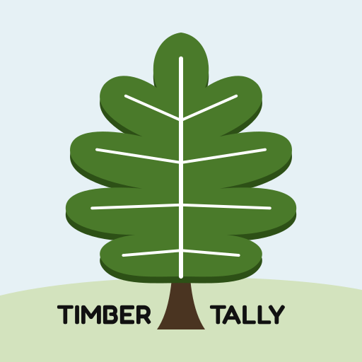

# TimberTally



A Progressive Web App (PWA) designed for simple and efficient offline-first collection of timber inventory data. Record plot number, area letter, tree species, DBH, log count, cut/UGS status, optional notes, and GPS location directly in the field — then export comprehensive CSV reports and publication-quality graphs when you're back at the desk.

*Contact: timbertallyapp@gmail.com*

## Understanding the App

*   [TimberTally Reference Guide](https://timbertally.github.io/TimberTally/timbertally_reference.html) — Calculations explained, CSV output guide, and proof of work in one tabbed document.
*   [Privacy Policy](https://timbertally.github.io/TimberTally/privacy.html)

---

## Features

### Offline-First PWA
Uses a Service Worker to cache all application files after the first load, allowing the app to run fully without network access. Includes automatic update detection with a prompted in-app update notification.

### Data Entry (Data Tab)
The field entry form from ForestScribe, built for one-handed use:

*   **Plots / Area Notes** — buttons at the top of the Data tab, beside the project name and "Area A · Plot 3".
    *   **Plots** lists every plot in an Area with its tree count, BA/acre and GPS. **Go** jumps to a plot to keep entering trees there. **Move** renumbers a plot or moves it to another Area; its trees, empty-plot record and GPS points go with it. Moving onto a plot that already has trees combines the two (you are warned first). A safety copy is kept before every move. An empty plot can be removed with ✕.
    *   **Area Notes** opens a notes box for the current Area (switch Areas inside it). Each Area keeps its own notes, saved as you type. A dot on the button shows the current Area has notes.
*   **Area / Plot #** — joined -/+ steppers side by side (Area A–Z, Plot 1–999). Swipe left or right across them to change plots. The Plot # label shows how many trees are already in the current plot, and the Plots Needed estimate sits just below.
*   **Species** — the 8 species you use most appear as quick-pick buttons (2 rows of 4, refreshed every 10 entries; long names are shortened to fit, e.g. Northern Red Oak to N. Red Oak). Common hardwoods fill the first row until you have your own. The full list is in the dropdown below, which starts blank so a tree is never saved as the wrong species by accident.
*   **DBH / Logs** — scroll wheels (4 to 40 in. DBH; 0.5 to 6 logs or Cull). The wheel follows your finger, stops when your finger stops, and a flick coasts a short way; tap a row to pick it, or use a mouse wheel on a computer. Trees 10 in. and under are always 0 logs.
*   **Cut / UGS** — toggle chips (UGS = Unacceptable Growing Stock; default AGS).
*   **Tool buttons** — GPS (saves the location with the next tree), Compass, and Notes (opens a note box for this tree; a dot shows when a note is written).
*   **Submit Entry** — stays pinned to the bottom of the screen while you scroll.
*   **Record empty plot** — when the current plot has no trees, a link under Submit records it as an empty plot so it still counts toward the number of plots (otherwise per-acre values come out too high). Empty plots export as an EMPTY PLOT row in the CSV and load back the same way.
*   **Edit an entry** — tap any row in Recent Entries to change its area, plot, species, DBH, logs, Cut/UGS or notes, or delete it.
*   **Borderline trees** — the line under the wheels shows the limiting distance for the DBH on the wheel at the current BAF; tap it to check a measured distance (IN / OUT) and see a quick table.
*   **GPS** — the GPS button averages several readings for a steadier point, shows the accuracy as it improves, and warns when it is weak (worse than 15 m). If location access is already allowed, each plot's 3rd tree gets a location automatically.
*   **Field-proofing** — pinch and double-tap zoom are off, the installed app stays in portrait, and a double tap on Submit saves the tree only once.

### Plots Needed Display
Estimates plots required for the current Area to reach 10%, 20% and 30% precision, calculated from the Coefficient of Variation across plots within that Area (t=2). Shown under the Area / Plot counters on the Data tab. Requires at least 2 plots in the current Area.

### Saving, Backup & Safety Copies
TimberTally 3 saves like ForestScribe:

*   **Live projects** — the open project is the saved copy. Every tree, edit, plot move, stand note and recommendation is written to it immediately, and again when the screen locks or you switch apps. On restart the app opens the same project at the same plot and area. There is no "recover unsaved data?" prompt, and nothing is ever deleted at startup.
*   **Honest save status** — the header shows the time of the last save. If a save fails (for example, device storage is full) a red bar appears on every screen size explaining what to do, and the header shows "⚠ Not saved".
*   **Safety copies** — a full copy of the project is kept automatically before Delete All Data, deleting selected entries, deleting a project, clearing an Area's notes, moving a plot, or adding a CSV. Copies are listed on the Projects tab for 7 days, and restoring one adds it as a new project.
*   **Backup files** — **Save Backup** writes one `.json` file with every project, your species list and plan details (phones open the share sheet so it can go to Files, email or a cloud drive). **Restore Backup** only adds: projects already on the device are skipped, and a project that differs is added as a "(restored)" copy. Nothing on the device is replaced.
*   **Backup reminder** — a banner appears when changes have gone 7 days without a backup (tap Later to snooze for a day).
*   **Storage protection** — the app asks the browser to keep its storage rather than clear it to free space. The Projects tab shows whether that was granted and how much space is used.
*   **Separate from TimberTally 2** — TimberTally 3 keeps its own storage. On first run it copies in TimberTally 2's saved projects, working data (as the open project), stand notes, settings and species list. TimberTally 2's data is left in place.

### Forestry Settings
Accessed via the ⚙ Settings button in the header (collapses/expands; sticks to the top of the screen alongside the header). Settings are saved locally and persist between sessions:

*   **BAF** — Basal Area Factor (5, 10, 20, 30, 40).
*   **Log Rule** — Doyle, Scribner, or International ¼".
*   **Form Class** — Doyle only (70–86 in even steps; hidden for other rules).
*   **Dark Mode** — Off, On, or System (follows device preference).

Additional buttons in Settings: **Check Updates**, **Install App** (PWA install prompt, shown when available), **Tree ID Key**, and **ℹ Info** (opens the README).

### Dark Mode
Full dark mode with a forest-green palette. Toggled via Settings or automatically matched to system preference. All UI elements, tables, dropdowns, and backgrounds are fully themed — alternating table rows use distinct shades of dark green rather than white, keeping all text readable.

### Projects Tab
*   **Open Project** — the name of the project you are working in (edit it to rename). Below it: trees, plots and the last backup date.
*   **Switch to Another Project** — opens another project. The one you leave is already saved.
*   **+ New Project / Copy / Delete Project** — start a fresh cruise, save a copy of the open one, or delete it (a safety copy is kept for 7 days).
*   **Backup & Restore** and **Safety Copies** — see Saving, Backup & Safety Copies above.
*   **Import CSV** — choose or drag a `.csv` file to add its trees to the open project. Prompts for an Area Letter (A–Z) to assign to all imported entries. Plot numbers are renumbered if the chosen area already contains data.

### Species Tab
Manage the species list used across all dropdowns:

*   **Add Species** — Type a name and click "+ Add" to add a new species.
*   **Remove Species** — A scrollable multi-select list lets you select one or more species to remove.

### Tally Tab (Tally & Stocking)
On-screen summary of all collected data, filterable by Area:

*   **Summary Cards** — Key metrics at a glance: Trees/Acre, BA/Acre, Avg DBH (QMD), Vol/Acre, number of plots, and total tree entries.
*   **Gingrich Stocking Chart** — every Area on the **Gingrich (1967) stocking chart** for upland hardwoods (the same drawing as ForestScribe), drawn automatically when the tab opens. Trees per acre across, basal area per acre up, with the A-line (100%), B-line (60%), the 50–120% stocking curves, average-diameter lines and shaded Overstocked / Fully stocked / Understocked zones. Each Area is a filled dot; when trees are marked Cut, a dashed arrow runs to a hollow circle for the stand left after the cut. The table above it gives TPA, BA/acre, QMD and percent stocking (with the level) for each Area, and for the residual stand when there is a cut. Stocking uses the Gingrich equation (−0.00507·N + 0.01698·ΣD + 0.00317·ΣD²) read on the chart basis (trees/acre and QMD), so the percent, the level and the plotted point always agree.
*   **Tree Tally** — Full breakdown by Species → DBH → Logs → Cut status.
*   **Stand Charts** — the same four charts, in the same colours, as the Graphs page in the saved ZIP: Basal Area Distribution and Trees Per Acre Distribution (by DBH class, cut/leave), Volume by Species (board feet/acre), and Sawtimber Volume by Species (small/medium/large sawtimber).

### Recs Tab (Recommendation Builder)
A simple way to write the management recommendations for each Area, using the standard recommendation library from ForestScribe (48 recommendations in 9 categories: TSI, harvest & regeneration, invasive species, wildlife, pests & storm damage, and more).

*   **Area** — recommendations are kept separately for each Area letter (defaults to the Area you are collecting on the Data tab).
*   **Library buttons** — tap a category to open it, then tap a recommendation to add it (tap again to remove). Hover a button to see its text. Some recommendations ask for a detail when added (e.g. which invasive species); anything left blank becomes a write-in line.
*   **Plan Details** — wording is set for Kentucky and the Kentucky Division of Forestry. Pick the **County** from the list of all 120 Kentucky counties and its **NRCS office phone** fills in. Confirmed USDA Service Center numbers are built in for Allen, Barren, Edmonson, Hart, Simpson and Warren (add more to `kentucky-counties.js` for everyone). For any other county, type the number once and it is remembered on that device. Typing over a built-in number corrects it on that device; **Use built-in** puts the list's number back.
*   **Edit** — change any wording, reorder with ↑/↓, remove, or add your own custom recommendation. Markup: `**bold**`, `__underline__`, a line starting with `• ` is a bullet, blank line = new paragraph.
*   **Preview** — the finished, numbered recommendations. **Copy Recommendations** copies formatted text (bold, bullets and tables survive a paste into Word or Google Docs), with an option to include titles.

Recommendations are saved with the open project (and in backup files); they are not included in CSV exports.

---

## Saving: one ZIP with everything

Tap **💾 Save ZIP** (top right). Everything for the open project goes into one `.zip` file, so a phone saves it in one step (the share sheet opens: Files, email, Drive…; a computer downloads it). All numbers use the current Settings (BAF, Log Rule, Form Class).

```
ProjectName_TimberTally_YYYYMMDD_HHMM.zip
  ProjectName_AreaA_DoylFC78_BAF10.csv        one per Area
  ProjectName_AreaA_Summary_Report.png        one per Area
  ProjectName_AreaA_Graphs.png                one per Area
  ProjectName_Stocking_Chart_All_Areas.png    every Area on one chart
  ProjectName_Area_Notes.txt                  when any Area has notes
```

### Area CSV
1.  **Raw Data** — All entries for that area: Plot#, Area, DBH, Species, Logs, Cut, UGS, Notes, Latitude, Longitude.
2.  **Tally Summary** — Tree counts grouped by Species, DBH, Logs, and Cut status.
3.  **Per-Plot Volume & Statistics** — Volume (BF/Acre) per plot, plus Mean, Variance, Std Dev, and CV across plots within the area.
4.  **Forestry Report** — Full stand tables including overall summary (Vol/Acre, TPA, BA/Acre, QMD for Total/Cut/Leave), Stand Distribution by DBH size class, Species Composition by TPA percentage, and Volume by Species (Small/Medium/Large Sawtimber BF/Acre).

### Area Summary Report
A landscape one-page summary PNG (4200×2700px) with the key stand metrics, distribution tables, species summaries and plot statistics.

### Area Graphs page
The four stand charts (Basal Area, Trees Per Acre, Volume by Species, Sawtimber Volume) on a single **11 × 8.5 in landscape page** (2200×1700px, 200 dpi), ready to print on letter paper. They match the charts on the Tally tab.

### Stocking chart
The Gingrich stocking chart with every Area (the same drawing as the Tally tab).

### Area notes
Every Area's notes in one `.txt` file, grouped by Area.

---

## How to Use

1.  **Open the App** in a modern browser (Chrome, Firefox, Edge, Safari) on desktop or mobile. After the first load, the app works fully offline.
2.  **Install (Optional)** — On supported browsers, accept the install prompt or use the "Install App" button in Settings for a native-like home screen experience.
3.  **Recover Data (If Prompted)** — If unsaved data from a previous session is found, confirm to restore it.
4.  **Configure Settings** — Click ⚙ Settings to set BAF, Log Rule, Form Class and Dark Mode. Collapse when done.
5.  **Set Plot # and Area** — Use the +/− buttons on the Data tab to set your current plot number and area letter. Reference the "Plots Needed" display beside the Notes field for sampling guidance.
6.  **Enter Tree Data** — Select Species, DBH, and Logs. Check Cut and/or UGS if applicable. Optionally tap GPS to record coordinates or add a per-tree note. Click **✔ Submit Entry**.
7.  **Manage Species** — Use the Species tab to add or remove species from the dropdown.
8.  **Manage Projects** — Use the Projects tab to save, load, or delete named projects. Load external CSV files via the file picker or by dragging and dropping a `.csv` directly onto the drop zone.
9.  **Add Area Notes** — Tap Area Notes on the Data tab for each Area's observations. Notes save automatically and export as a `.txt` file.
10. **Review Data** — Use the Tally tab to view summary cards, species/DBH breakdowns, and live charts. Use the Area dropdown to filter by area.
11. **Check Stocking** — Open the Tally tab: the Gingrich chart for every Area is drawn automatically.
12. **Use the Compass** — Click 🧭 Compass (above the Recent Entries table on the Data tab) to open the on-screen compass. Grant orientation permission if prompted.
13. **Delete Entries** — Check entries in the Recent Entries table and click 🗑 Delete. Use ⚠ Delete All Data (with confirmation) to clear everything.
14. **Export** — Tap **💾 Save ZIP** to save everything for all areas as one file.

---

## Technical Details

*   Built with vanilla HTML, CSS, and JavaScript — no frameworks or build tools.
*   **PWA** via Service Worker for full offline support and in-app update notifications.
*   **localStorage** keys used:
    *   `timberTallyTempSession` — autosave / session recovery.
    *   `timberTallyCustomSpecies` — custom species list.
    *   `timberTallyProjects` — named saved projects.
    *   `timberTallySettings` — BAF, log rule, form class, dark mode.
    *   `timberTallyStandNotes` — persistent stand-level notes.
*   **Chart.js** (`v4.4.1`, included in `lib/`) — the stand charts on the Tally tab and the Graphs page (the Gingrich chart is drawn as SVG).
*   **JSZip** (`v3.10.1`, included in `lib/`) — builds the saved ZIP. Both libraries ship with the app, so charts and saving work offline from the first use.
*   **Volume calculations** — Doyle (FC70–86, scaled from embedded FC78 table), Scribner, and International ¼" log rules. Trees <10" DBH return 0 board feet (below sawtimber threshold).
*   **Gingrich stocking chart** — TPA (x-axis) vs. BA/Acre (y-axis); curves computed from the Gingrich (1967) stocking equation, as in ForestScribe.
*   **Summary Report PNG** — drawn entirely via the HTML5 Canvas 2D API (no Chart.js) at 3× logical resolution (4200×2700px physical) for print-quality output at 100% zoom.
*   **Device APIs used** — Geolocation API (GPS), Device Orientation API (compass), beforeinstallprompt (PWA install).
*   **Sticky header** — The app header and collapsible settings panel are wrapped in a single sticky block; the tab bar sticks directly below it with no gap. Height is measured dynamically via JavaScript on load, resize, and settings toggle.
*   **Pull-to-refresh suppressed** — `overscroll-behavior: none` is applied to both `html` and `body` to prevent the Android Chrome pull-to-refresh indicator from appearing during normal scrolling.

---

## Files

| File | Purpose |
|---|---|
| `index.html` | App structure and all UI markup |
| `style.css` | Stylesheet — light and dark mode, responsive layout |
| `script.js` | All app logic — data entry, settings, projects, export, compass, etc. |
| `forestry-calc.js` | Forestry calculation functions (TPA, BA, volume, stocking, tally) |
| `forestry-data.js` | Static lookup tables — Doyle/Scribner/International volume tables, default species list |
| `kentucky-counties.js` | Kentucky's 120 counties and the NRCS phone numbers built into the Recs tab |
| `charts.js` | The four stand charts (Tally tab and Graphs page), Gingrich stocking chart, summary report canvas |
| `lib/chart.umd.min.js`, `lib/jszip.min.js` | Chart.js 4.4.1 and JSZip 3.10.1 (MIT), included so the app needs no CDN |
| `manifest.json` | Web App Manifest for PWA install and theming |
| `service-worker.js` | Caching and offline support |
| `icon.png` | App icon |
| `README.md` | This file |
| `timbertally_reference.html` | Reference guide — calculations, CSV output, and proof of work |
| `privacy.html` | Privacy policy |

---

## Notes

*   All data stored in `localStorage`. Clearing browser site data will erase saved projects, species, settings, and notes. Exporting CSV files is the primary way to permanently preserve collected data.
*   GPS accuracy depends on device hardware and environmental conditions.
*   Compass accuracy depends on device sensors and calibration. Keep the device away from metal objects. The heading source type (absolute, webkit, alpha) is indicated in the compass display.
*   The Summary Report PNG is generated at 4200×2700px (3× scale) for crisp printing and screen viewing without zoom. File size is typically 4–6 MB.
