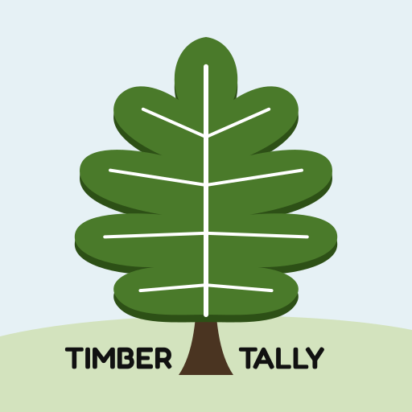

# TimberTally



A Progressive Web App (PWA) designed for simple and efficient offline-first collection of timber inventory data. Record plot number, area letter, tree species, DBH, log count, cut/UGS status, optional notes, and GPS location directly in the field — then export comprehensive CSV reports and publication-quality graphs when you're back at the desk.

**Contact:** questions, problems or ideas → [timbertallyapp@gmail.com](mailto:timbertallyapp@gmail.com) (also under **☰ Menu → Info / Contact** in the app; **? → Report a Problem** opens an email with the app version filled in).

**New here?** Tap the **?** at the top (Help & Tours) for a tour of the tab you are on, or print the two-page [Quick Start sheet](TimberTally-Quick-Start.pdf). Or open **Projects → Try the Sample Project** to explore a made-up property with two cruised Areas. A small **ⓘ** beside a term (DBH, TPA, BA, QMD, BAF, CV, stocking…) gives a one-line plain-English meaning.

## Installing the App

Installed, TimberTally opens from its own tree icon, full screen, and works with no signal. Tap **☰ Menu → Install App**: when the browser offers an install it happens in one tap; otherwise the button shows these steps for your device.

| Device | How to install |
|---|---|
| Android (Chrome) | **⋮** menu → **Install app**. If it only says *Add to Home screen*, reopen the site and wait a few seconds — *Add to Home screen* makes a shortcut with a Chrome badge. |
| Android (Samsung Internet) | **☰** → **Add page to** → **Home screen** |
| iPhone / iPad | Open in **Safari** → **Share** → **Add to Home Screen** |
| Windows / Mac (Chrome or Edge) | The install icon at the right end of the address bar, or the browser menu → install TimberTally |

Firefox can't install web apps (on Android it adds a badged shortcut), so use Chrome, Edge, Samsung Internet or Safari. After an icon change, phones can take a day or two to show the new icon; removing and reinstalling shows it at once.

## Understanding the App

*   [TimberTally Reference Guide](https://timbertally.github.io/TimberTally/timbertally_reference.html) — Calculations explained, CSV output guide, and proof of work in one tabbed document.
*   [Privacy Policy](https://timbertally.github.io/TimberTally/privacy.html)

---

## Features

### Offline-First PWA
Uses a Service Worker to cache all application files after the first load, allowing the app to run fully without network access. Includes automatic update detection with a prompted in-app update notification.

### Data Entry (Data Tab)
The field entry form from ForestScribe, built for one-handed use:

*   **Plots / Area Notes** — buttons at the top of the Data tab, beside the project name and "Area A · Plot 3".
    *   **Plots** lists every plot in an Area with its tree count, BA/acre and GPS. **Go** jumps to a plot to keep entering trees there. **Move** renumbers a plot or moves it to another Area; its trees, empty-plot record and GPS points go with it. Moving onto a plot that already has trees combines the two (you are warned first). A safety copy is kept before every move. An empty plot can be removed with ✕.
    *   **Area Notes** opens a notes box for the current Area (switch Areas inside it). Each Area keeps its own notes, saved as you type. **Acres in this Area** (optional) is here too: with acres for every Area, the Property Summary gives property totals. Below the notes, **Regeneration** records the Area's regeneration with one tap each: density (Abundant / Adequate / Sparse / None), deer browse (None to Heavy), ground cover, the invasive species seen, and a species & size line. A dot on the button shows the current Area has notes or regeneration. Both go into the Area Notes file in the ZIP.
*   **Area / Plot #** — joined -/+ steppers side by side (Area A–Z, Plot 1–999). Swipe left or right across them to change plots. The Plot # label shows how many trees are already in the current plot, and the "Enough plots?" panel sits just below.
*   **Species** — the 8 species you use most appear as quick-pick buttons (2 rows of 4, refreshed every 10 entries; long names are shortened to fit, e.g. Northern Red Oak to N. Red Oak). Common hardwoods fill the first row until you have your own. The full list is in the dropdown below, which starts blank so a tree is never saved as the wrong species by accident. **edit species** beside the heading opens the species list to add or remove names; **Done** returns to the Data tab.
*   **DBH / Logs** — scroll wheels (4 to 40 in. DBH; logs or Cull — only the log counts the volume tables hold for that DBH: ½–4 logs at 12–18 in., up to 5 at 20–26 in., up to 6 at 28 in. and up, in half logs; Tap Grid offers the same choices, and a log count too high for a new DBH is lowered to the largest it allows). The wheel follows your finger, stops when your finger stops, and a flick coasts a short way; tap a row to pick it, or use a mouse wheel on a computer. Trees 10 in. and under are always 0 logs.
*   **Tap Grid** (☰ Menu → Settings → Collection → Tap Grid) — in place of the wheels: tap a DBH button, then a Logs button, and the tree is saved (set Cut / UGS first). It saves the same way as Submit, GPS and notes included; switching back to the wheels keeps your selection.
*   **Cut / UGS** — toggle chips (UGS = Unacceptable Growing Stock; default AGS).
*   **Tool buttons** — GPS (saves the location with the next tree), Compass, and Notes (opens a note box for this tree; a dot shows when a note is written).
*   **Submit Entry** — stays pinned just above the tab bar while you scroll.
*   **Record empty plot** — when the current plot has no trees, a link under Submit records it as an empty plot so it still counts toward the number of plots (otherwise per-acre values come out too high). Empty plots export as an EMPTY PLOT row in the CSV and load back the same way.
*   **Edit an entry** — tap any row in Recent Entries to change its area, plot, species, DBH, logs, Cut/UGS or notes, or delete it.
*   **Borderline trees** — the line under the wheels shows the limiting distance for the DBH on the wheel at the current BAF (or, on fixed plots, the plot radius); tap it to check a measured distance (IN / OUT) and see a quick table.
*   **GPS** — the GPS button averages several readings for a steadier point, shows the accuracy as it improves, and warns when it is weak (worse than 15 m). If location access is already allowed, each plot's 3rd tree gets a location automatically.
*   **Field-proofing** — pinch and double-tap zoom are off, the installed app stays in portrait, and a double tap on Submit saves the tree only once.

### Enough Plots? Panel
Under the Area / Plot counters on the Data tab, for the current Area (needs 2+ plots). Collapsed, it is one line: **Plots needed ±10%: N ±15%: N ±20%: N**, with a green ✓ when the Area already has that many plots. Tap it (▸) to open the details, as in ForestScribe: **Enough plots?** ✓ Yes / Not yet (yes at a sampling error of 15% or less), the sampling error and mean volume (BF/ac), the 95% confidence interval, standard error (SE) and CV, and plots needed again. The app remembers whether it is open. Plots needed = ⌈(t × CV ÷ E)²⌉ with t = 2 and E = 10, 15 and 20, from the per-plot volume stats (BAF or fixed plots, empty plots included), so it matches the Summary Report. It updates after every tree and when the Area, plot or project changes.

### Tab Bar
The tabs — **Data, Projects, Tally, Recs** — sit in a bar fixed to the bottom of the screen (icon over a short label; the open tab is highlighted), clear of the iPhone home bar. On the Data tab, Submit Entry sits directly above it. Species are managed from **edit species** on the Data tab, not a tab of their own.

### Saving, Backup & Safety Copies
TimberTally 3 saves like ForestScribe:

*   **Live projects** — the open project is the saved copy. Every tree, edit, plot move, stand note and recommendation is written to it immediately, and again when the screen locks or you switch apps. On restart the app opens the same project at the same plot and area. There is no "recover unsaved data?" prompt, and nothing is ever deleted at startup.
*   **Honest save status** — the header shows the time of the last save. If a save fails (for example, device storage is full) a red bar appears on every screen size explaining what to do, and the header shows "⚠ Not saved".
*   **Safety copies** — a full copy of the project is kept automatically before Delete All Data, deleting selected entries, deleting a project, clearing an Area's notes, moving a plot, adding a CSV, or merging another device. The action only goes ahead once the copy is really saved. Copies are listed on the Projects tab for 7 days, and restoring one adds it as a new project.
*   **Backup files** — **Save Backup** writes one `.json` file with every project, your species list, plan details and Standard Wording (phones open the share sheet so it can go to Files, email or a cloud drive). **Restore Backup** only adds: projects already on the device are skipped, and a project that differs is added as a "(restored)" copy. Nothing on the device is replaced.
*   **Backup reminder** — a banner appears when changes have gone 7 days without a backup (tap Later to snooze for a day). Locking the screen or switching apps saves anything pending but does not count as a change.
*   **Two windows** — if the installed app and a browser tab (or two tabs) have the same project open, a save in one is picked up by the other ("Updated from another window"). If both save at the same moment, the trees from both are kept.
*   **Storage protection** — the app asks the browser to keep its storage rather than clear it to free space. The Projects tab shows whether that was granted and how much space is used.
*   **Separate from TimberTally 2** — TimberTally 3 keeps its own storage. On first run it copies in TimberTally 2's saved projects, working data (as the open project), stand notes (into Area notes), settings and species list. TimberTally 2's data is left in place.

### ☰ Menu
The **☰** button at the top right (beside 💾 Save ZIP and **?**) opens a short menu: **Settings**, **Help & Tours**, **Quick Start sheet**, **Standard Wording**, **Install App** (installs in one tap when the browser offers it, otherwise shows the install steps for your phone or computer), **Check for Updates**, and **Info / Contact** (a short guide, the contact address, and links to the Quick Start sheet, this README, the Reference Guide and the Privacy Policy). A choice, a tap outside the menu or Esc closes it. Code: `menu.js`.

### Help & Tours
The **?** at the top (or ☰ Menu → Help & Tours) opens the Help sheet, as in ForestScribe:

*   **Tour of this screen** — a tour of whichever tab is open (or of Settings when that is open).
*   **All tours** — Data entry, Projects & backup, Tally & Check Data, Recommendations, and Settings. Each opens its tab (or the Settings sheet) and rings the real controls one at a time; Next / Back / Done, ← → and Esc work. Steps for controls that aren't on screen (e.g. BAF on a fixed-plot cruise) are skipped.
*   **Quick Start sheet** — the printable two pages (`TimberTally-Quick-Start.pdf`, also offline).
*   **Install on your phone** — the install steps, and an Install App button.
*   **Report a Problem** — opens an email to timbertallyapp@gmail.com with the subject "TimberTally problem", the app version and browser filled in, and a blank "What happened:". No project data is included.

The Data tour is still offered once on first run (with Try the Sample). Code: `tour.js` (tours, sample project), `menu.js` (Help sheet).

### Quick Start Sheet
`TimberTally-Quick-Start.pdf` — two letter pages: install, set up, enter trees, check your work, recommendations, save & back up, and help. Its source is `quick-start.html`; after changing it, rebuild the PDF with `node build-quick-start.cjs` (uses Playwright's Chromium from the ForestScribe repo; set `PLAYWRIGHT_DIR` to point elsewhere). The script warns if a page overflows. The phone screenshots in `quick-start/` are retaken from the Sample Project with `node quick-start-shots.cjs [url]` while the app is served (default http://localhost:8099).

### Forestry Settings
Opened from **☰ Menu → Settings** as a full-height sheet; **Done**, Esc or a tap outside it closes it. Settings are saved locally as you change them and persist between sessions:

*   **Cruise Method** — **Prism (BAF)** or **Fixed plot**. With fixed plots, pick the **Plot Size** (1/4, 1/5, 1/10, 1/20 or 1/50 acre); every tree then counts as 1 ÷ plot acres per acre, and reports, file names and charts say e.g. "Fixed 1/5 ac".
*   **BAF** — Basal Area Factor (5, 10, 20, 30, 40), for prism cruises.
*   **Collection** — Scroll Wheel or Tap Grid (see Data Entry).
*   **Log Rule** — Doyle, Scribner, or International ¼".
*   **Form Class** — Doyle only (70–86 in even steps; hidden for other rules).
*   **Dark Mode** — Off, On, or System (follows device preference).

**☰ Menu → Leaf/Twig ID** opens the tree ID key (a **Leaf Key / Twig Key (Winter)** switch at the top; November–March it opens on the twig key). Check for Updates, Install App, Help and Info are in the ☰ Menu too.

### Dark Mode
Full dark mode with a forest-green palette. Toggled via Settings or automatically matched to system preference. All UI elements, tables, dropdowns, and backgrounds are fully themed — alternating table rows use distinct shades of dark green rather than white, keeping all text readable.

### Projects Tab
*   **Open Project** — the name of the project you are working in (edit it to rename). Below it: trees, plots and the last backup date.
*   **Switch to Another Project** — opens another project. The one you leave is already saved.
*   **+ New Project / Copy / Delete Project** — start a fresh cruise, save a copy of the open one, or delete it (a safety copy is kept for 7 days).
*   **Backup & Restore** and **Safety Copies** — see Saving, Backup & Safety Copies above.
*   **Try the Sample Project** — adds a new project of made-up cruise data (two Areas) to explore. Your projects are not changed.
*   **Import CSV** — choose or drag a `.csv` file to add its trees to the open project. A TimberTally CSV asks for an Area Letter (A–Z) for all its entries; plot numbers are renumbered if that Area already contains data. **Another program's CSV** opens **Match Columns**: it guesses which column is Plot, Area, Species, DBH, Logs, Cut, UGS, Notes, Latitude and Longitude (change any of them), reads logs as 16' logs, 8' sticks or feet, translates species codes (FIA numbers such as 802, or letter codes such as WO), previews the first rows, and lists any codes it couldn't translate (kept as written). With an Area column, each row keeps its own Area letter.
*   **⇄ Merge Another Device** — combine a second cruiser's work into the open project: pick their backup `.json` (choose the project if it holds several) or a TimberTally CSV. Choose **Different plots — renumber after the last plot** (default) or **Same plots — combine trees** (two people tallying one plot). A safety copy is kept first, exact duplicate entries are skipped, Area notes are added under a "— from … —" line, and a summary of what was added (e.g. "Area A: 3 trees, plots 10–12" or "plot 10" for one) appears in the Merge section.
*   **📍 Export Plot Locations** — one point per plot that has GPS (named "Area A Plot 3", with trees and BA/acre), as **KML** (Google Earth), **GPX** (GPS units, Avenza) or **GeoJSON** (GIS).

### Species Tab
Manage the species list used across all dropdowns:

*   **Add Species** — Type a name and click "+ Add" to add a new species.
*   **Remove Species** — A scrollable multi-select list lets you select one or more species to remove.

### Tally Tab (Tally & Stocking)
On-screen summary of all collected data, filterable by Area:

*   **Summary Cards** — Key metrics at a glance: Trees/Acre, BA/Acre, Avg DBH (QMD), Vol/Acre, number of plots, and total tree entries.
*   **✓ Check Data** — field data checks ported from ForestScribe, for every Area or the one picked in the Area filter: skipped plot numbers (gaps not recorded as empty plots), plots recorded with no trees, a plot with far more trees than the rest (two plots entered as one?), likely double entries (the same tree saved twice in the same plot within 3 seconds; for entries without a save time, the same tree twice in a row), log counts beyond the volume table for the DBH and log rule (they count as 0 board feet), logs on trees 10" and under, 4+ logs on a tree 14" or under, trees 40" and over, missing species or DBH, and plots without GPS when other plots have it. Shows "No problems found" when clean. Tap a tree's issue to open its Edit Entry box; the list refreshes after the edit. Code: `check-data.js`.
*   **Gingrich Stocking Chart** — every Area on the **Gingrich (1967) stocking chart** for upland hardwoods (the same drawing as ForestScribe), drawn automatically when the tab opens. Trees per acre across, basal area per acre up, with the A-line (100%), B-line (60%), the 50–120% stocking curves, average-diameter lines and shaded Overstocked / Fully stocked / Understocked zones. Each Area is a filled dot; when trees are marked Cut, a dashed arrow runs to a hollow circle for the stand left after the cut. The table above it gives TPA, BA/acre, QMD and percent stocking (with the level) for each Area, and for the residual stand when there is a cut. Stocking uses the Gingrich equation (−0.00507·N + 0.01698·ΣD + 0.00317·ΣD²) read on the chart basis (trees/acre and QMD), so the percent, the level and the plotted point always agree.
*   **Tree Tally** — Full breakdown by Species → DBH → Logs → Cut status.
*   **Stand Charts** — the same four charts, in the same colours, as the Graphs page in the saved ZIP: Basal Area Distribution and Trees Per Acre Distribution (by DBH class, cut/leave), Volume by Species (board feet/acre), and Sawtimber Volume by Species (small/medium/large sawtimber).

### Recs Tab (Recommendation Builder)
A simple way to write the management recommendations for each Area, using the standard recommendation library from ForestScribe (48 recommendations in 9 categories: TSI, harvest & regeneration, invasive species, wildlife, pests & storm damage, and more).

*   **Area** — recommendations are kept separately for each Area letter (defaults to the Area you are collecting on the Data tab).
*   **Library buttons** — tap a category to open it, then tap a recommendation to add it (tap again to remove). Hover a button to see its text. Some recommendations ask for a detail when added (e.g. which invasive species); anything left blank becomes a write-in line.
*   **Plan Details** — wording is set for Kentucky and the Kentucky Division of Forestry. Pick the **County** from the list of all 120 Kentucky counties and its **NRCS office phone** fills in. Confirmed USDA Service Center numbers are built in for Allen, Barren, Edmonson, Hart, Simpson and Warren (add more to `kentucky-counties.js` for everyone). For any other county, type the number once and it is remembered on that device. Typing over a built-in number corrects it on that device; **Use built-in** puts the list's number back.
*   **Edit** — change any wording, reorder with ↑/↓, remove, or add your own custom recommendation. Markup: `**bold**`, `__underline__`, a line starting with `• ` is a bullet, blank line = new paragraph.
*   **Preview** — the finished, numbered recommendations. **Copy Recommendations** copies formatted text (bold, bullets and tables survive a paste into Word or Google Docs), with an option to include titles. **Copy as plain text** copies the same list with no formatting, ready to paste into an email or text message.

Recommendations are saved with the open project (and in backup files); they are not included in CSV exports.

### Standard Wording
**☰ Menu → Standard Wording** lists the whole recommendation library by category, to put it in your own words (as in ForestScribe; the wording is the forester's own):

*   Tap a recommendation to edit its **title** and **text** (same markup as the Recs tab: `**bold**`, `__underline__`, `• ` bullets, blank line = new paragraph). Changed ones are marked *Edited*. **Reset to standard** puts one back; **Reset all** puts every one back and deletes your own.
*   **+ Add your own** under any category adds a library recommendation of your own (marked *Yours*); it can be moved to another category or deleted.
*   `{{blanks}}` (asked for when a recommendation is added, such as the pest or invasive species) and the `{{COUNTY}}` / `{{NRCS_PHONE}}` / `[[if:…]]` marks must stay in the text; a warning shows when an edit removes one.
*   The Recs tab library buttons and newly added recommendations use your wording. **Recommendations already added to an Area keep their text.**
*   Saved on this device (`tt3.wording` in localStorage) and in **Save Backup**. Restoring a backup adds its wording without replacing what you changed on this device. Code: `wording.js`.

---

## Saving: one ZIP with everything

Tap **💾 Save ZIP** (top right). Everything for the open project goes into one `.zip` file, so a phone saves it in one step (the share sheet opens: Files, email, Drive…; a computer downloads it). All numbers use the current Settings (BAF, Log Rule, Form Class).

```
ProjectName_TimberTally_YYYYMMDD_HHMM.zip
  ProjectName_AreaA_DoylFC78_BAF10.csv        one per Area, stand & stock tables at the bottom (fixed plots: ..._FIX0.2ac.csv)
  ProjectName_AreaA_Summary_Report.png        one per Area
  ProjectName_AreaA_Graphs.png                one per Area
  ProjectName_Property_Summary.png            when 2 or more Areas have trees
  ProjectName_Stocking_Chart_All_Areas.png    every Area on one chart
  ProjectName_Area_Notes.txt                  when any Area has notes
```

### Stand & Stock table
For each Area: species down the side, 2" DBH classes across, with row and column totals, in three blocks: trees per acre, basal area per acre and board feet per acre. When any tree is marked Cut, the same three blocks follow for the Cut trees only. Totals match the Area's summary numbers.

### Property Summary
One 11 × 8.5 in landscape page for the whole project: a row per Area (acres, plots, TPA, BA/acre, QMD, BF/acre, total BF, stocking, and Cut BF/acre when trees are marked), a TOTAL row weighted by acres, the property's sampling error (±% at 95% confidence, each Area weighted by its acres), and every Area on the Gingrich chart. Enter each Area's acres in Area Notes for the totals; without them the page lists the Areas and says so. The Tally tab shows the same table under the stocking table when **All Areas** is selected.

### Area CSV
1.  **Raw Data** — All entries for that area: Plot#, Area, DBH, Species, Logs, Cut, UGS, Notes, Latitude, Longitude.
2.  **Tally Summary** — Tree counts grouped by Species, DBH, Logs, and Cut status.
3.  **Per-Plot Volume & Statistics** — Volume (BF/Acre) per plot, plus Mean, Variance, Std Dev, and CV across plots within the area.
4.  **Forestry Report** — Full stand tables including overall summary (Vol/Acre, TPA, BA/Acre, QMD for Total/Cut/Leave), Stand Distribution by DBH size class, Species Composition by TPA percentage, and Volume by Species (Small/Medium/Large Sawtimber BF/Acre).

### Area Summary Report
One **11 × 8.5 in landscape page** (2200×1700px, 200 dpi), ready to print on letter paper: volume, trees and basal area per acre (Total / Cut / Leave) and QMD across the top; Stand Distribution by size class, Gingrich Stocking (as cruised and after the marked cut) and Sampling Statistics (CV, sampling error, plots needed) on the left; one Species table with composition and sawtimber volume, largest volume first, on the right. Rows and text size adjust so the page is full whether the Area has 3 species or 30; when there's room, the Area's stocking chart fills the space under the species table.

### Area Graphs page
The four stand charts (Basal Area, Trees Per Acre, Volume by Species, Sawtimber Volume) on a single **11 × 8.5 in landscape page** (2200×1700px, 200 dpi), ready to print on letter paper. They match the charts on the Tally tab.

### Stocking chart
The Gingrich stocking chart with every Area (the same drawing as the Tally tab).

### Area notes
Every Area's notes in one `.txt` file, grouped by Area.

---

## How to Use

1.  **Open the App** in a modern browser (Chrome, Edge, Samsung Internet or Safari; Firefox works but can't install it) on desktop or mobile. After the first load, the app works fully offline.
2.  **Install (Optional)** — Tap ☰ Menu → **Install App**. See *Installing the App* below.
3.  **Take the Tour (Optional)** — the **?** at the top → a tour of any tab, the Quick Start sheet, or Projects → Try the Sample Project.
4.  **Configure Settings** — ☰ Menu → Settings to set the cruise method (BAF or fixed plot size), Log Rule, Form Class, Collection (Scroll Wheel or Tap Grid) and Dark Mode. Tap Done when finished.
5.  **Set Plot # and Area** — Use the +/− buttons on the Data tab to set your current plot number and area letter. The "Enough plots?" line under them shows the plots needed for ±10/15/20%; tap it for the sampling error.
6.  **Enter Tree Data** — Select Species, DBH, and Logs. Check Cut and/or UGS if applicable. Optionally tap GPS to record coordinates or add a per-tree note. Click **✔ Submit Entry**.
7.  **Manage Species** — Tap **edit species** beside the Species heading on the Data tab to add or remove species from the dropdown; **Done** returns to the Data tab.
8.  **Manage Projects** — Use the Projects tab to save, load, or delete named projects. Load external CSV files via the file picker or by dragging and dropping a `.csv` directly onto the drop zone.
9.  **Add Area Notes** — Tap Area Notes on the Data tab for each Area's observations. Notes save automatically and export as a `.txt` file.
10. **Review Data** — Use the Tally tab to view summary cards, species/DBH breakdowns, and live charts. Use the Area dropdown to filter by area.
11. **Check Stocking** — Open the Tally tab: the Gingrich chart for every Area is drawn automatically.
12. **Use the Compass** — Click 🧭 Compass (above the Recent Entries table on the Data tab) to open the on-screen compass. Grant orientation permission if prompted.
13. **Delete Entries** — Check entries in the Recent Entries table and click 🗑 Delete. Use ⚠ Delete All Data (with confirmation) to clear everything.
14. **Export** — Tap **💾 Save ZIP** to save everything for all areas as one file.

---

## Technical Details

*   Built with vanilla HTML, CSS, and JavaScript — no frameworks or build tools.
*   **PWA** via Service Worker for full offline support and in-app update notifications.
*   **Storage** (all on the device; nothing is sent to a server):
    *   **IndexedDB** database `timbertally3` (store `kv`) — projects (`tt3.p.*`), the project list (`tt3.index`) and safety copies (`tt3.snaps`, `tt3.snap.*`). Loaded into memory at startup, so the app reads instantly; a save only shows ✓ once IndexedDB has written it.
    *   **localStorage** — settings (`tt3.settings`), species list (`tt3.species`), recommendation plan details (`tt3.recDetails`), the backup-reminder snooze, the tour flag, and TimberTally 2's old keys (`timberTally*`, read once to copy them in).
    *   The first time this version runs, projects saved in localStorage by earlier TimberTally 3 versions are copied into IndexedDB; the old copies are left in place. If a browser can't open IndexedDB (some private windows), the app keeps using localStorage as before. If IndexedDB fails to open on a device that used it before, the app warns, keeps saving to localStorage, and the next time IndexedDB opens it brings in every project saved meanwhile that is newer than its IndexedDB copy (the older copy is kept as a safety copy).
*   **Chart.js** (`v4.4.1`, included in `lib/`) — the stand charts on the Tally tab and the Graphs page (the Gingrich chart is drawn as SVG).
*   **JSZip** (`v3.10.1`, included in `lib/`) — builds the saved ZIP. Both libraries ship with the app, so charts and saving work offline from the first use.
*   **Volume calculations** — Doyle (FC70–86, scaled from embedded FC78 table), Scribner, and International ¼" log rules. Trees <10" DBH return 0 board feet (below sawtimber threshold). Plots are counted by Area + plot number, so on **All Areas** plot 1 in Area A and plot 1 in Area B are two plots. A tree with no species or DBH is counted as an INVALID stem but adds no basal area, so the Stand Distribution totals match the summary.
*   **CSV text** — species and notes are quoted (quotes doubled, line breaks kept inside the quotes), and text starting with = + - @ gets a leading ' so a spreadsheet won't run it as a formula (TimberTally removes it again on import). Match Columns leaves out rows with plot numbers above 999 and says how many.
*   **Gingrich stocking chart** — TPA (x-axis) vs. BA/Acre (y-axis); curves computed from the Gingrich (1967) stocking equation, as in ForestScribe.
*   **Summary Report PNG** — drawn entirely via the HTML5 Canvas 2D API (no Chart.js) as an 11 × 8.5 in landscape page (2200×1700px, 200 dpi).
*   **Device APIs used** — Geolocation API (GPS), Device Orientation API (compass), beforeinstallprompt (PWA install).
*   **Sticky header** — The app header and collapsible settings panel are wrapped in a single sticky block (it pads for the notch with `env(safe-area-inset-top)`; the viewport uses `viewport-fit=cover`). Its height is measured on load, resize and settings toggle into `--sticky-block-height`. The tab bar is fixed to the bottom (`--bottom-tabs-h`, includes `env(safe-area-inset-bottom)`); Submit Entry sticks above it and the pages pad their bottom so nothing hides behind it.
*   **Pull-to-refresh suppressed** — `overscroll-behavior: none` is applied to both `html` and `body` to prevent the Android Chrome pull-to-refresh indicator from appearing during normal scrolling.

---

## Files

| File | Purpose |
|---|---|
| `index.html` | App structure and all UI markup |
| `style.css` | Stylesheet — light and dark mode, responsive layout |
| `script.js` | All app logic — data entry, settings, projects, export, compass, etc. |
| `forestry-calc.js` | Forestry calculation functions (TPA, BA, volume, stocking, tally) |
| `forestry-data.js` | Static lookup tables — Doyle/Scribner/International volume tables, default species list |
| `kentucky-counties.js` | Kentucky's 120 counties and the NRCS phone numbers built into the Recs tab |
| `charts.js` | The four stand charts (Tally tab and Graphs page), Gingrich stocking chart, summary report canvas |
| `storage.js` | Projects, safety copies and backups (IndexedDB, with localStorage fallback) |
| `scroll-wheel.js` | The DBH and Logs scroll wheels |
| `tap-grid.js` | Tap Grid entry mode |
| `glossary.js` | The ⓘ term meanings |
| `property.js` | Area acres, Property Summary page and Stand & Stock tables |
| `merge.js` | Merge Another Device |
| `csv-match.js` | Match Columns for other programs' CSVs, species code translation |
| `plot-export.js` | Plot locations as KML, GPX or GeoJSON |
| `twig-key.js` | Winter twig key and the Leaf / Twig switch |
| `check-data.js` | ✓ Check Data on the Tally tab (field data checks) |
| `tour.js` | Help tours (one per tab, and Settings) and the sample project |
| `menu.js` | The ☰ Menu and the Help & Tours sheet (Report a Problem) |
| `wording.js` | Standard Wording editor (the forester's own library wording) |
| `info.js` | The in-app Info screen |
| `quick-start.html`, `TimberTally-Quick-Start.pdf` | Quick Start sheet (source and the 2-page PDF) |
| `build-quick-start.cjs` | Rebuilds the Quick Start PDF: `node build-quick-start.cjs` |
| `quick-start-shots.cjs`, `quick-start/` | Retakes the Quick Start screenshots from the Sample Project: `node quick-start-shots.cjs [url]` |
| `recommendations.js`, `recommendations-data.js` | Recs tab and its recommendation library |
| `lib/chart.umd.min.js`, `lib/jszip.min.js` | Chart.js 4.4.1 and JSZip 3.10.1 (MIT), included so the app needs no CDN |
| `manifest.json` | Web App Manifest for PWA install and theming |
| `service-worker.js` | Caching and offline support |
| `icon.png`, `icon-192.png` | App icon (512 and 192 px) |
| `icon-maskable-512.png` | Android icon with the art inside the safe zone, so the circle/rounded crop keeps "TIMBER TALLY" |
| `apple-touch-icon.png` | iPhone / iPad home-screen icon (180 px) |
| `README.md` | This file |
| `timbertally_reference.html` | Reference guide — calculations, CSV output, and proof of work |
| `privacy.html` | Privacy policy |

---

## Development

The app has no build step: GitHub Pages serves these files as they are. A `package.json` holds development tools only (lint and tests; Node 20+):

```
npm install
npx playwright install chromium webkit   # once
npm run check                             # lint + unit tests + browser tests
git config core.hooksPath .githooks       # once: runs npm run check before every push
```

What each test covers, the release checklist (bump `CACHE_NAME` in `service-worker.js`, `npm run release-check`, phone tests on iPhone and Android) and how to update the golden numbers after an intended calculation change are in [TESTING.md](TESTING.md).

---

## Notes

*   All data is stored on the device (see Storage above). Clearing the browser's site data erases saved projects, species, settings and notes, so use **Save Backup** regularly; a backup file restores everything, and the ZIP's CSVs can be loaded back too.
*   GPS accuracy depends on device hardware and environmental conditions.
*   Compass accuracy depends on device sensors and calibration. Keep the device away from metal objects. The heading source type (absolute, webkit, alpha) is indicated in the compass display.
*   The Summary Report and Graphs pages are 2200×1700px PNGs (11 × 8.5 in at 200 dpi) and print on letter paper, landscape, at 100%.
